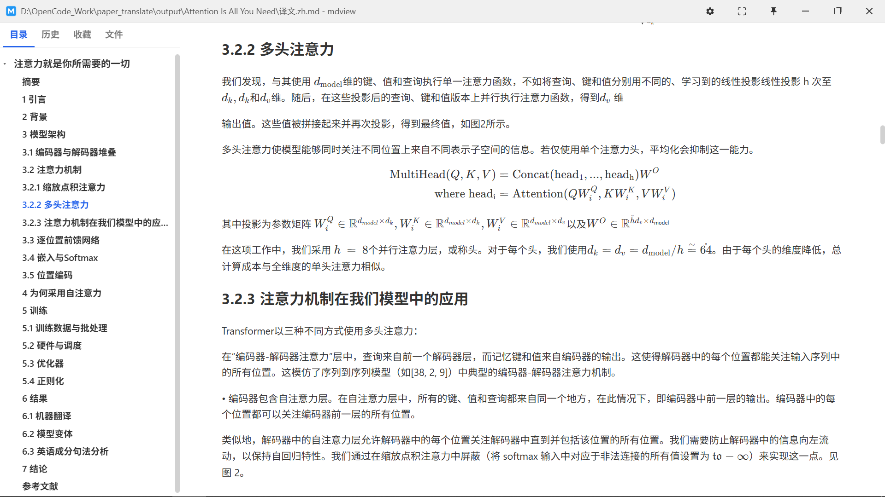
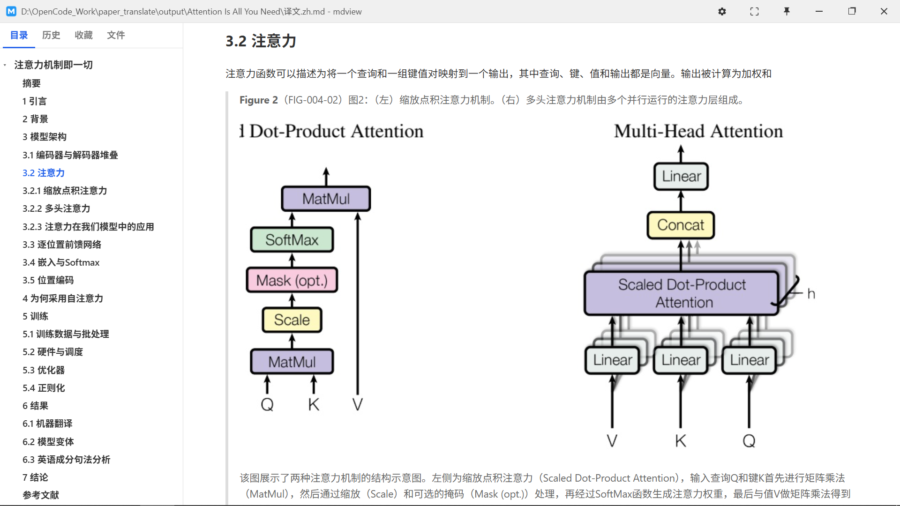

# PDF:Paper Decoding Flow - An automatic translation and parsing tool for academic papers, friendly to both human and agents.

**PDF 学术论文 → 深度理解包**：一条命令产出「中文译文 + LaTeX 公式注册表 + 图表内容描述」，面向个人知识库 / Agent RAG 场景。

## 写在前面

关于任何bug和建议，欢迎给 ~~我~~ 我的AGENT 提issue。

## 功能

| 痛点 | 方案 | 产出 |
|---|---|---|
| 公式变乱码 / 被翻译毁掉 | 公式剥离为 LaTeX + 占位符保护 + 语法回验 | `formulas/` |
| 图表只是图片，无法检索 | 多模态模型生成中文描述 + 数据表 | `figures/` |
| 译文无法进知识库 | 语义块翻译 + 页码/坐标溯源层 | `译文.zh.md` + `segments.json` |
| 配环境劝退 | Windows `run.bat` 自举：自动装 Python/依赖/引导填 key，拖拽即用 | 首次双击后免维护 |

## 工作原理

```
PDF ─► S1 MinerU解析 ─► S2 公式剥离 ─► S3 图表理解 ─► S4 翻译 ─► S5 组装
        (CPU 本地)       (CPU 本地)     (VLM API)    (LLM API)   (本地)
```

版面/OCR/公式/表格识别全部 CPU 本地运行（MinerU basic 档）；仅图表理解与翻译调用 API；有本地 GPU 时可整体升级。

## 快速开始

### 已支持Windows（推荐：自动配置 + 拖拽）

```bash
git clone git@github.com:Hennessey2005/AI_Paper_Translater.git
```

打开仓库目录，**把 PDF 拖到 `run.bat` 图标上**（支持一次拖多个；也可双击后把文件拖入窗口回车）。首次运行自动完成：缺 Python 则引导安装 → 建 venv 装依赖 → 记事本打开 `config\config.yaml` 引导填 API key，之后秒进。处理完成后自动打开结果目录。

### 手动 / 其他平台

```bash
python -m venv .venv && .venv\Scripts\activate     # Windows
pip install -e .

copy config\config.example.yaml config\config.yaml  # 填入你的 API key（已 gitignore）
paper-translate paper.pdf
```

常用参数：

```bash
paper-translate paper.pdf --offline                       # 仅本地阶段，不调 API
paper-translate paper.pdf --cache-dir output/_cache/<hash> # 复用解析缓存
paper-translate paper.pdf --open                          # 完成后打开输出目录
python -m paper_translate paper.pdf                        # 未安装命令时
```

默认适配硅基流动（OpenAI 兼容协议），模板已预填实测模型：图表理解 `Qwen/Qwen3-VL-32B-Instruct`、翻译 `deepseek-ai/DeepSeek-V4.1-Flash`，换平台只需改 `base_url`、`api_key` 和模型名（注意 VLM 需支持 `enable_thinking` 参数的密集系列多模态模型，见模板注释）。

## 输出结构

```
output/<论文标题>/
├── 译文.zh.md          # 中文译文（公式 LaTeX 内嵌、图表原位描述）
├── 译文.bilingual.md   # 中英对照
├── formulas/           # 公式注册表（编号/页码/LaTeX/回验状态）
├── figures/            # 图表理解（图注译文/VLM 描述/数据表）
├── segments.json       # 溯源层：译文段 ↔ PDF 页码/坐标
└── _cache/             # 缓存（断点续跑不重复计费）
```

输出目录自动以 **PDF 内的论文真实标题**命名（取自解析结果，纯本地；标题非法字符自动清洗、超 80 字符截断；同名论文以内容哈希后缀区分，同篇重跑复用目录），也可用 `-o` 指定。

> 📖 **阅读建议**：译文是含 LaTeX 公式的纯 Markdown，推荐用轻量阅读器 [mdview](https://github.com/mdview2026/mdview) 打开——双击 `.md` 即渲染阅读；社区版免费，**Pro 为付费**（约 ¥10 一次性买断、可离线），解锁 KaTeX 数学渲染与 Mermaid，公式密集的译文建议用 Pro。

## 效果展示（mdview 渲染 `译文.zh.md`）

公式处理：行内公式与展示公式均以 Markdown 数学语法保留原始 LaTeX，KaTeX 渲染，左侧目录可跳转：



图表处理：图注译文原位引用 + 裁剪原图 + VLM 生成的中文内容描述：



## 实测指标（Attention Is All You Need · arXiv 1706.03762v7 · 15 页双栏 · 纯 CPU）

冷启动全流程约 **13 分钟 / < ¥1**：S1 解析 223.5s（本地免费）+ S2–S5 约 530s；图表理解 9 项（5 表 + 4 图）约 12.7k tokens，翻译 103 单元约 40.7k tokens，API 合计约 53k tokens；显示公式语法回验 5/5，端到端自检 4/4 PASS；解析/翻译缓存命中后重跑 0 次 API 调用（约 7 min 纯本地重算）。

## 项目结构

```
run.bat                # Windows 拖拽入口（首跑自动配置环境）
src/paper_translate/   # cli / orchestrator / S2-S5 阶段模块 / title_naming / VLM+LLM 客户端
scripts/               # M1-M4 阶段回归测试 + 标题命名回归 + 模型选型对比
config/                # 配置模板 + 术语表（可积累）
```

## 相关链接

- [MinerU](https://github.com/opendatalab/MinerU)：本项目的本地文档解析引擎（版面 / OCR / 公式 / 表格识别）
- [PyMuPDF](https://github.com/pymupdf/PyMuPDF)：致敬其「直读 PDF 文本层」的轻量思路。并非所有论文都需要完整解析管线——若只需快速文本提取或轻量级翻译预处理，PyMuPDF 直读文本层是成本最低的替代路线
- [mdview](https://github.com/mdview2026/mdview)（[官网](https://www.mdview.top/)）：推荐的译文阅读器。双击即渲染的轻量 Markdown 查看器（约 2MB、跨平台），社区版永久免费，Pro 版付费买断（约 ¥10，可离线）增加 KaTeX 数学、Mermaid 与编辑模式；本项目产出含大量内嵌 LaTeX 公式，配合支持 KaTeX 的 Pro 版阅读体验最佳
- [硅基流动](https://siliconflow.cn)：VLM 图表理解与 LLM 翻译的 API 服务
